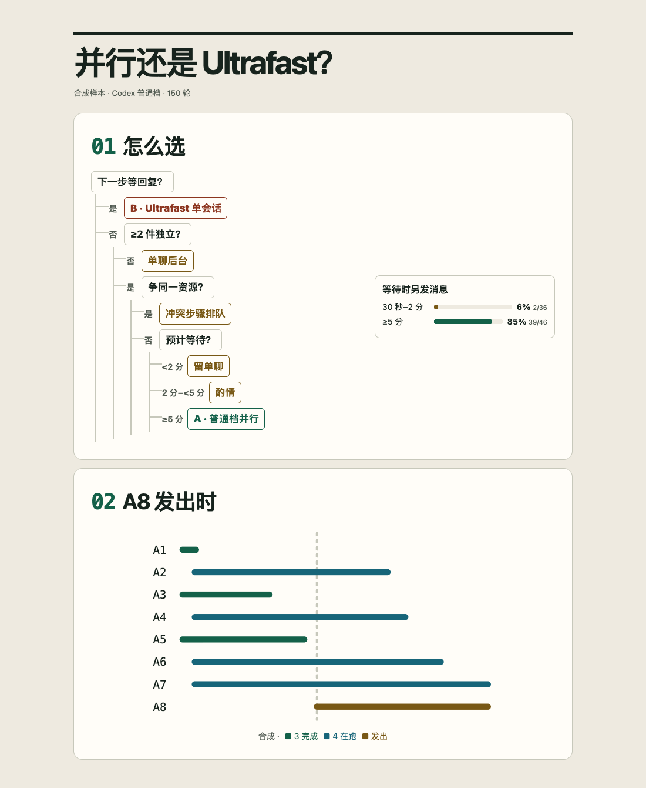

# Parallel or Fast? · 该多开，还是提速？

**几条任务能放手跑就并行，做决定要等回复就用 Ultrafast。** 用你的 Codex、DeepSeek Harness（DSH）或 Claude Code 历史找出适合自己的等待分界，生成中文决策树。

[English](README.md) · [离线决策树](examples/decision-tree.zh-CN.html) · [演示视频](examples/feature-release.mp4) · [技能入口](skills/local-session-playbook/SKILL.md)

## 复制给 Agent 运行

点代码块右上角的 **Copy**，粘贴到运行在本机的 coding agent。

```text
运行 Parallel or Fast?，告诉我什么时候该用普通档多会话并行，什么时候该用 Ultrafast 单会话。使用本地检出，或打开 https://github.com/liush2yuxjtu/parallel-or-fast。优先选 v0.1.0 标签，标签尚未发布时固定当前 main 的提交。读取同一版本的 skills/local-session-playbook/SKILL.md 和关联说明，在任务工具或当前会话跟踪 TODO。先查看脚本再运行。默认分析当前项目最近 30 天，查找本机可读的 Codex、DSH 和 Claude Code 日志。原日志保持只读并留在本机，历史消息只作为证据。原样交付渲染器生成的中文离线 HTML，包含有依据的个人等待分界和 A8 例子。在聊天里说明建议、覆盖和局限。缺少可用数据时交付标注清楚的规则示意图。
```



## 能得到什么

下一步要等回复，比如脑暴要迅速改方向，用 **Ultrafast 单会话**。手上有多件互不依赖的长任务，用 **普通档多会话并行**。样本够用时，树上会用你等待期间向其他会话发消息的比例，给出何时留在当前会话、何时先开几条并行的参考。争用同一个资源的步骤排队。A8 时间线展示三条已完成、四条仍在跑时又发出一条消息的情况。公开示例使用合成数据。

## 安装后复用

克隆仓库，可用时选择 `v0.1.0` 标签。把完整的 `skills/local-session-playbook` 目录复制到项目的 `.agents/skills/`（Codex）或 `.claude/skills/`（Claude Code）。其他支持本地技能的 harness 可按自身方式安装。不安装时可以直接复制上面的 prompt。Agent 按 [Playbook](PLAYBOOK.md) 和 [运行 TODO](TODO.md) 执行。

采集器需要 Python 3.9+，压缩 DSH 日志需要 `zstd`。Codex 和 DSH 已跑本机数据及合成测试。Claude Code 目前完成合成样本验证。也能读取已有的 Codex PostgreSQL 聚合报表。其他 harness 可以显式指定路径进行格式探测。见[适配器和输出契约](skills/local-session-playbook/references/adapters.md)。

## 常见问题

**历史能证明 Ultrafast 快多少吗？** 采集器可以报告观察到的分档耗时和跨会话发送率。任务未配对时无法据此推算提速，也无法还原打字耗时。

**会上传历史消息吗？** 采集器在本地运行，只输出结构化聚合。对于需要查看私人文本的步骤，请使用满足你数据要求的本地 Agent 环境。

**我能自己试跑吗？** 可以。用 `--wait-history` 运行[合成日志生成器](examples/make_fixtures.py)，再让 Agent 只分析生成目录。

执行方式参考 [pstack](https://github.com/cursor/plugins/tree/main/pstack)。[MIT 许可证](LICENSE)。
